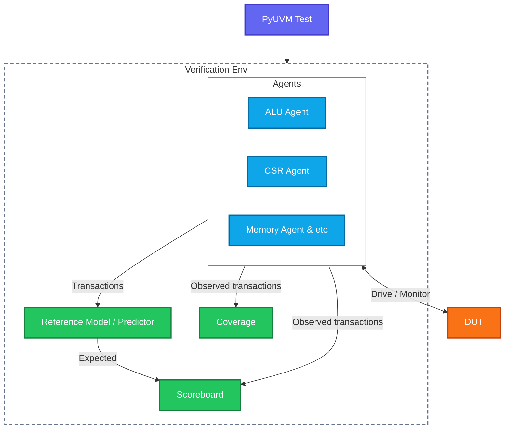
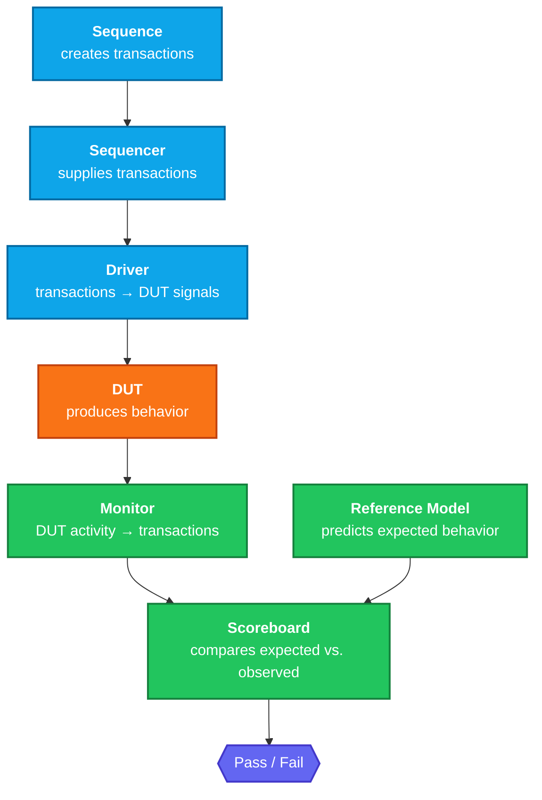
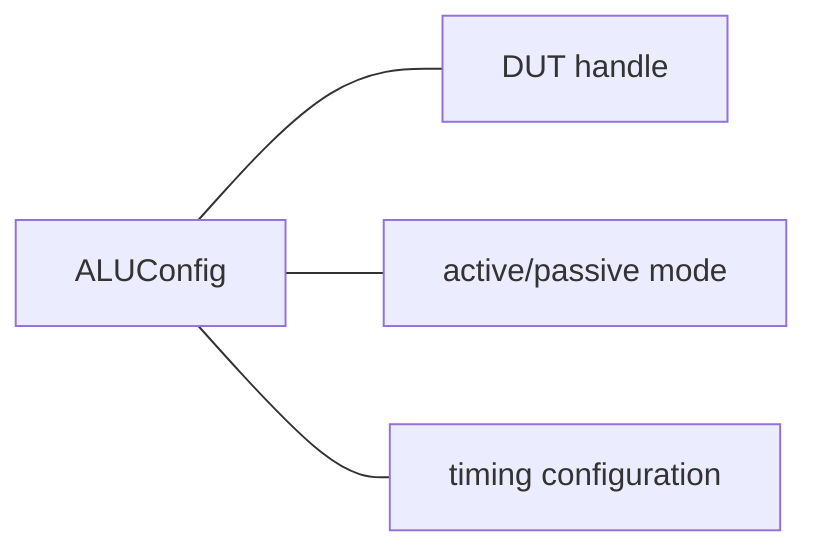
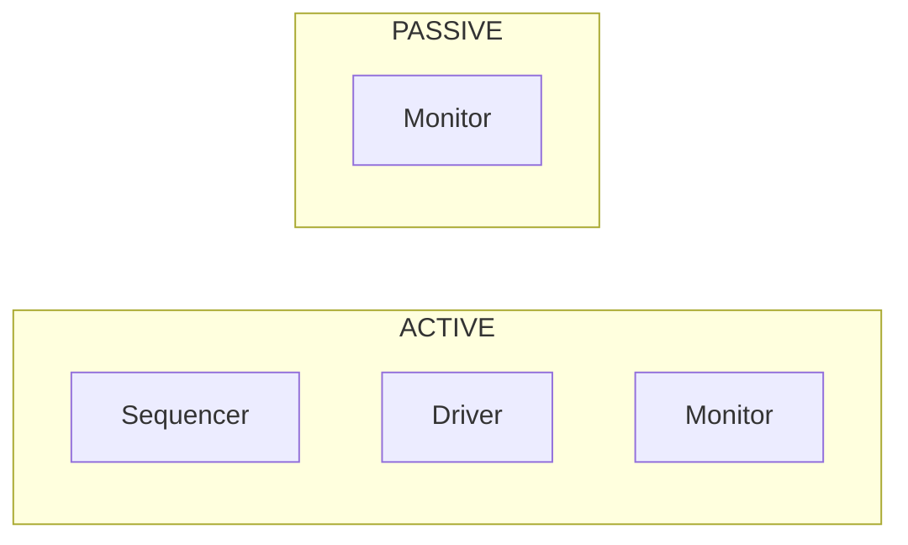
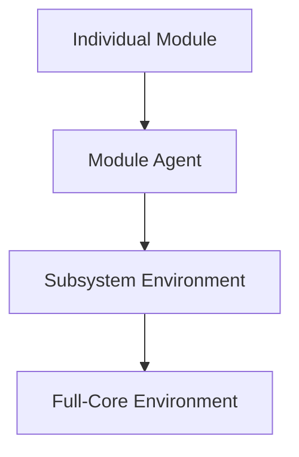
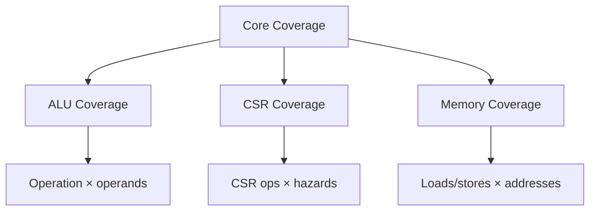
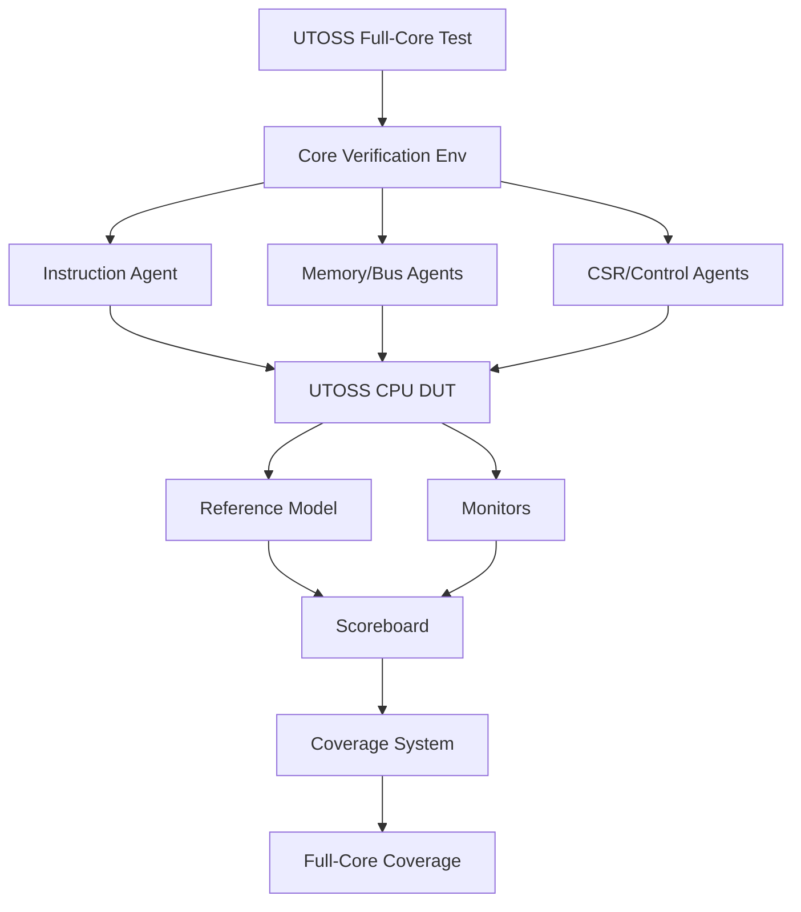
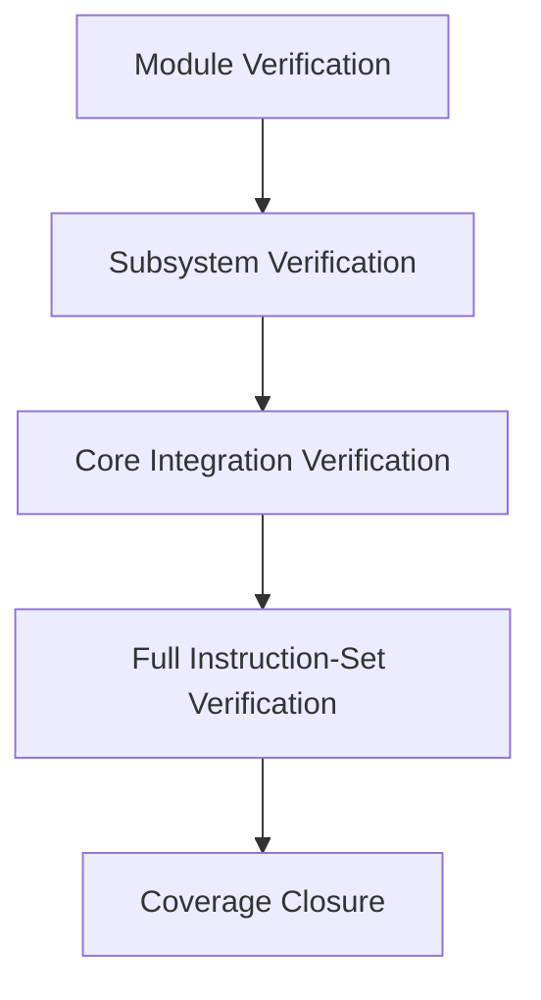
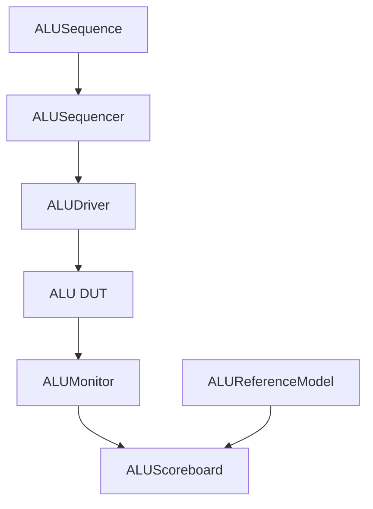

# PyUVM Verification Infrastructure

A modular Python-based verification infrastructure for the UTOSS RISC-V processor, built with PyUVM and cocotb.

The infrastructure is designed to start with focused module-level verification and scale toward comprehensive full-core verification as the processor develops.

## Running verification

The devcontainer and CI image install the dependencies from `PyUVM/requirements.txt`,
including cocotb, pyuvm, and pytest. Rebuild or pull the updated container to use them.
For a separate environment, install them with `python3 -m pip install -r PyUVM/requirements.txt`;
Verilator, a C++ compiler, make, and Python development libraries are also required.

From the repository root, run `make test_pyuvm` to execute the reference-model unit
tests, the ALU simulation, and the full-core ECALL and CSR suites with `RV32IZicsr`.
CI runs this same command and uploads the cocotb JUnit reports.

```sh
make -C PyUVM                              # ALU simulation only
make -C PyUVM MODULE=test_ecall             # ECALL suite (defaults to RV32IZicsr)
make -C PyUVM MODULE=test_ecall WAVES=1      # ECALL suite with dump.vcd
make -C PyUVM MODULE=test_ecall TESTCASE=test_ecall_wrong_path
make -C PyUVM MODULE=test_csr               # Full-core instruction-driven CSR suite
```

ECALL and CSR tests also accept `UTOSS_RISCV_CONFIG=<configuration>`; it must include
`Zicsr`. Simulator builds are isolated by test module, core configuration, and
waveform setting. Reports are written to `PyUVM/results-*.xml`, and test failures
make the command fail.

The ECALL and CSR suites run programs on `envs/simulation/top.sv`. Shared backdoor loading,
program execution, and register/store monitors live in `core/`; the ECALL program,
sequence, trap monitor, scoreboard, and environment live in `ecall/`.
`test_ecall.py` uses cocotb entry points to run the UVM tests, matching the ALU suite.
The checks cover:

- Machine ECALL redirect to `mtvec`, saved `mepc`, and machine ECALL cause 11.
- A relocated handler and ECALL instruction address.
- Flushing younger register, memory, and CSR side effects while preserving older writes.
- Discarding an ECALL behind a taken jump.
- A legal CSR instruction that must not be decoded as ECALL.

The CSR suite uses the same program driver, register monitor, instruction encoders,
and backdoor access layer. Its independent reference model checks register results
and ordered software CSR write requests across register and immediate WRITE/SET/CLEAR
operations, x0 write suppression, read-only and unimplemented CSRs, and WARL masks.
Separate monitors capture hardware CSR requests and pipeline stall/flush/PC activity.

Each full-core program must reach its completion marker within a bounded cycle
count. The ECALL scoreboard compares complete register-write and trap-event
streams and checks a memory sentinel for unintended stores. The former lowercase
`pyuvm/` tree and its ADD smoke test have been replaced by this shared infrastructure.

### What the current suites establish

The current suites establish that the listed directed scenarios work in the full
core and that the checked architectural event streams match their reference
expectations. They are a useful baseline for this framework, not evidence that all
RISC-V behavior or all interactions have been verified.

To decide whether coverage is sufficient for a feature, write down its behavioral
requirements first and map each one to (1) stimulus that reaches it, (2) an
independent expected result, and (3) an observation that would fail if the DUT were
wrong. Check that both positive and negative cases are covered, including boundary
values, back-to-back instructions, hazards, and interactions with traps or flushes
where relevant. Review the mapping whenever the RTL or supported ISA changes.

For stronger evidence, add functional coverage for those requirement bins and
crosses, then use fault injection or temporary RTL mutations to confirm that the
scoreboard fails when a covered behavior is broken. A passing regression alone
cannot show that an un-stimulated behavior is correct.

For CSR specifically, the current program checks ordered GPR results and software
write requests, and requires CSR decode stalls to occur. The pipeline monitor
records flush and PC signals, but the CSR scoreboard does not yet compare those
streams against a cycle-accurate expectation. The CSR suite also does not exercise
CSR updates caused by traps; those are checked by the ECALL suite. Add cases for
these interactions, CSR read-after-write timing, randomized CSR sequences, and
coverage tracking as the feature's verification goals require. The read-only CSR
write checks currently verify the implemented write-mask behavior; architectural
illegal-instruction trapping for read-only access is outside this core's present
CSR contract.

### Adding a test

For another case in an existing domain, keep the stimulus, prediction, and checks
in that domain's existing components:

1. Add the instruction sequence or program mode in `csr/program.py` or
   `ecall/program.py`. Use `core/instructions.py` encoders and the shared
   `ProgramItem` fields for initial registers, completion, and timeout.
2. Extend the reference model independently of the DUT signals. Record expected
   register and CSR events in program order; do not use observed monitor values to
   construct expectations.
3. Add a UVM test class or test entry point in `test_csr.py` or `test_ecall.py` that
   creates the program and runs its sequence. Reuse the existing environment unless
   the new scenario needs a different set of monitors.
4. Add assertions in the domain scoreboard for the architectural events and any
   relevant side effects. Keep hierarchy access in `core/access.py`; add or extend
   a shared monitor there when a new core signal must be observed.
5. Add focused reference-model tests under `tests/` when model behavior changes.
   Run the selected case with `make -C PyUVM MODULE=test_csr TESTCASE=<name>` or
   `make -C PyUVM MODULE=test_ecall TESTCASE=<name>`, then run `make test_pyuvm`
   for the full regression.

For a new verification domain, create a directory containing its program or
transaction type, sequence, environment, monitors, reference model, and scoreboard.
Use `core/ProgramDriver` and the shared monitors where they fit. Add its cocotb test
module and register the module in `PyUVM/Makefile`; if it belongs in the standard
regression, add it to the root `test_pyuvm` target. Add a README run command and make
sure the top-level build enables the RTL configuration the test requires.

---

## Architecture

The verification infrastructure follows the UVM architecture of tests, environments, agents, sequences, drivers, monitors, scoreboards, reference models, and coverage collectors.

At a high level:



Each agent contains its own sequence, driver, and monitor (plus a sequencer when active).

### Core verification flow



* **Sequence:** determines what stimulus to generate.
* **Sequencer:** manages transaction delivery with async & await.
* **Driver:** converts high-level transactionshigh-level into signal-level DUT stimulus.
* **Monitor:** observes DUT behavior and reconstructs transactions.
* **Reference model:** independently predicts expected behavior.
* **Scoreboard:** compares expected and observed behavior.
* **Coverage:** measures which functional behaviors have been exercised.

This separation allows individual verification components to be reused as the DUT evolves.

---

## Configuration

Verification components receive environment-specific configuration through PyUVM's `ConfigDB`.

For example:



This allows the same agent to operate in different environments without hard-coding DUT connections or verification settings.

Agents can therefore be configured as either:



A passive agent can observe activity generated by another component without driving the DUT.

---

## Modular Verification Architecture

The infrastructure is intentionally organized by DUT domain.

```text
verification/
├── alu/
│   ├── transaction.py
│   ├── sequence.py
│   ├── driver.py
│   ├── monitor.py
│   ├── scoreboard.py
│   ├── reference_model.py
│   ├── coverage.py
│   └── config.py
│
├── csr/
│   └── ...
│
├── memory/
│   └── ...
│
├── register_file/
│   └── ...
│
└── core/
    └── ...
```

Each module/peripheral can have its own verification components while following the same PyUVM architecture.

This allows verification to be developed incrementally:



For example, the ALU can be verified independently before being integrated into the processor-level environment.

---

## Coverage Strategy

Coverage is also modular.

Individual coverage collectors should measure behavior relevant to their verification domain rather than placing all coverage logic into one large class.

For example:



As the processor grows, additional coverage domains can be added without modifying existing verification components.

Examples of eventual full-core coverage include:

* Instruction/opcode coverage
* ALU operation coverage
* Branch taken/not-taken coverage
* Load/store coverage
* Register usage coverage
* CSR operation coverage
* Hazard and forwarding coverage
* Exception/edge-case coverage
* Operand boundary coverage
* Functional crosses between relevant behaviors

The goal is not simply to maximize the number of executed instructions, but to measure whether the architecturally meaningful behaviors and corner cases of the processor have been exercised.

---

## Long-Term Full-Core Verification

This repository is intended to serve as a long-lived verification infrastructure rather than a collection of isolated tests.

The architecture provides an eventual entry point for full-core verification:



The intended progression is:



As new processor extensions, peripherals, pipeline features, hazards, and architectural behaviors are introduced, their verification components can be added to the existing infrastructure rather than creating independent testbenches.

---

## Current Implementation

The initial implementation uses the ALU as the first verification target.

The ALU environment demonstrates the complete PyUVM flow:



Functional coverage is collected independently through a `uvm_subscriber`.

This provides a small but complete proof-of-concept for the architecture that will eventually be applied to the complete UTOSS processor.

---

## Design Principles

**Modular**
Verification components should be reusable across different environments and integration levels.

**Independent reference models**
Expected behavior should be derived from an independent behavioral model rather than reproducing the RTL implementation.

**Configuration-driven**
DUT handles, active/passive modes, and environment-specific settings should be provided through configuration rather than hard-coded into individual components.

**Layered verification**
Module-level verification should remain useful even after components are integrated into the full processor.

**Coverage-driven development**
Verification should progressively measure whether meaningful architectural behaviors and corner cases have been exercised.

**Long-term scalability**
The infrastructure should support incremental development over the lifetime of the UTOSS processor rather than being tied to a single implementation or feature.

---

## Goal

Build a reusable PyUVM verification infrastructure that can begin with individual RTL modules and peripherals today, while providing the architectural foundation for comprehensive full-core verification and coverage closure as UTOSS evolves over the coming years.
