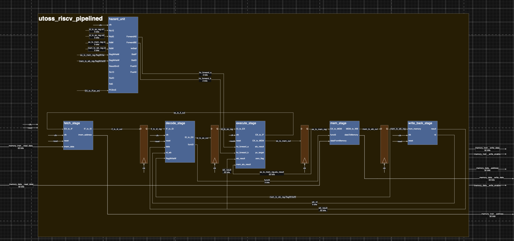
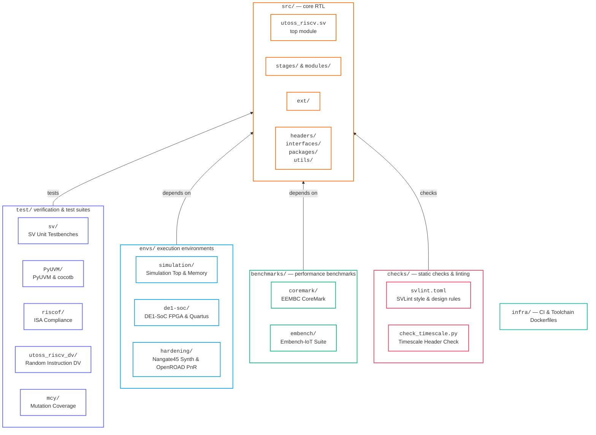

# risc-v

UTOSS' 5-stage pipelined RISC-V core with synchronous memory support.

## Architecture



## Getting Started

Checkout Setting up Developement Environment wiki page if you wuld like to develop locally. You can
also create a
[Codespace](https://docs.github.com/en/codespaces/about-codespaces/what-are-codespaces) which will
use our [devcontainer image](.devcontainer/Dockerfile) with all the necessary tools preinstalled.

## Project structure



## Development

Put new modules into `src/` folder.

### Formatting

We use SVLint to make sure our SystemVerilog code is well formatted. Use the following command to
check for new offences:
```
$ make svlint
```

### Testbenches

It is important that new functionality is tested to a reasonable extent by using test benches. To
run all existing testbenches use `make run_tb`

To create a new test bench, if you are on Linux use the following command:
```
$ make new_tb name="something"
```

If you are on Windows, create a new testbench file in `test/sv/` folder named `something_tb.sv` (the
`_tb.sv` suffix and extension are necessary for the test suite to recognize this file as a
testbench). Copy the content of `test/sv/tb_template.sv.m4` into your newly-created testbench file and
start writing the test bench.
